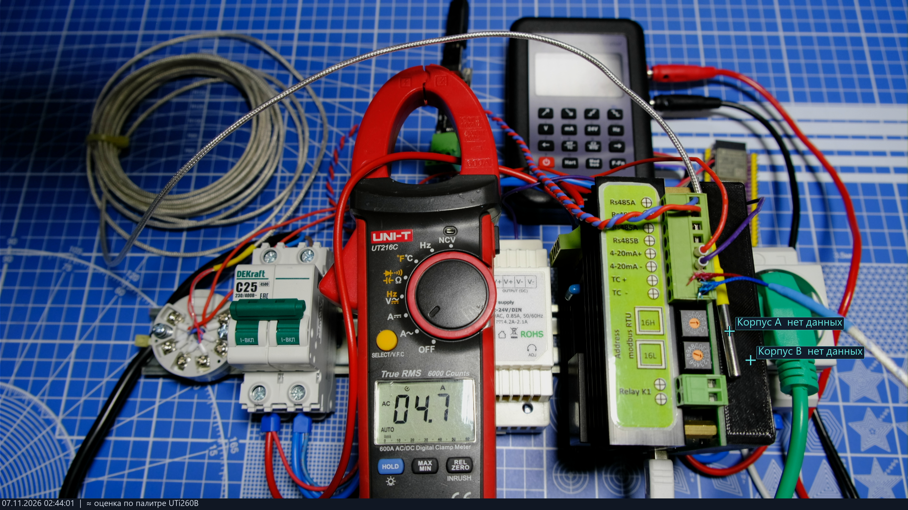
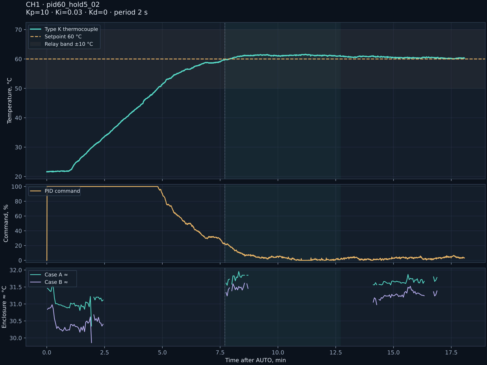

[Русский](README.md) | **English**

Publish in Russian first, then translate into English: [translation and freshness checks](docs/TRANSLATION.en.md).

# TemperatureController-CH1 — temperature under observation

Repository: [neuroandriyanov/TemperatureController-CH1](https://github.com/neuroandriyanov/TemperatureController-CH1).

**A single-channel temperature controller and an open measurement bench.** STM32F030C8T6, eight thermocouple types, AC RMS current, Modbus RTU, autonomous PID and triac burst control with a 2–300 s period.

A NeuroAndriyanov project: from schematics and source code to verifiable measurements. Current firmware: **2.5.0**, protocol: **2.4**. Parameters are stored in the device's EEPROM. The PC is used for configuration, calibration and observation; the controller is not limited to water or a particular heater.

The repository brings together custom electronics, firmware, four PC applications, schematics, an enclosure and real measurements. The project is developed through collaboration between a person and AI: from input checks and calibration to controller tuning and observation of heating. Raw data, unsuccessful experiments and limitations are retained so that others can verify and continue the work.



*An actual test frame: the controller on the right, the current clamp in the center and the calibrator behind them. Thermal markers were unavailable at this moment; the original labels have not been retouched. [Photographs and thermograms](measurements/2026-11-07_heater_60c/README.en.md), [hardware materials](hardware/README.en.md).*

## Where to start

| You want to… | Go to |
|---|---|
| Run the applications and build the firmware | [Quick start](docs/QUICKSTART.en.md) |
| Study the boards, enclosure and connections | [Hardware materials](hardware/README.en.md) |
| Write your own control application | [Modbus RTU and parameter map](firmware/docs/PROTOCOL.en.md) |
| See how testing was performed | [Bench, measurements, photographs and plots](measurements/README.en.md) |
| Continue development with AI | [Assistant guide](docs/AI_START.en.md) and [knowledge base](knowledge/README.en.md) |
| Check the original package | [Build and test report](docs/VALIDATION.en.md) |

The package also includes an [HTML overview with photographs](docs/index.en.html): after downloading the project, open `docs/index.en.html` in a browser.

## How the bench works

The MAX31856 reads the thermocouple, and the ACS712 measures load current. The STM32 calculates PID and controls the triac in bursts of mains cycles. Cold-junction compensation can use the internal sensor or an external Pt100 through a signal conditioner and the 4–20 mA input. Modbus RTU over RS-485 connects the device to the configuration application; after configuration, the controller operates independently.

The LB02A calibrator supplies reference signals. A conventional camera shows the bench and clamp readings, while the UTi260B thermal imager shows surface temperature distribution. The monitoring application aligns the images, transfers temperature markers and saves paired frames. These interfaces also allow an AI assistant to carry out explicitly requested measurements and record their results.

## Contents

| Directory | Contents |
|---|---|
| [apps/calibrator_lb02a](apps/calibrator_lb02a/README.en.md) | LB02A display and keys, ESP32-S3 bridge source code and connection photographs |
| [apps/thermal_monitor](apps/thermal_monitor/README.en.md) | Color video, UTi260B, layer alignment, temperature markers, paired snapshots and local API |
| [apps/controller](apps/controller/README.en.md) | Controller configuration, calibration, faults, temperature plot and AUTO/MANUAL/STOP |
| [apps/stm32_programmer](apps/stm32_programmer/README.en.md) | UART programmer: BIN/Intel HEX, inspection, backup, erase, write and verification |
| [firmware](firmware/README.en.md) | Current STM32 source, ST/ARM libraries, build and tests |
| [hardware](hardware/README.en.md) | PDF schematics, BOMs, Gerber, enclosure STL and photographs |
| [measurements](measurements/README.en.md) | Thermocouple, 4–20 mA loop, current, PID and enclosure temperature measurements |
| [knowledge](knowledge/README.en.md) | Knowledge base for the engineering assistant: sources, facts, limitations and checksums |

## Starting on a new PC

Windows 10/11 x64, Python **3.12–3.15** with Tcl/Tk. Extract the project to a writable folder. Internet access is required for the initial dependency installation.

```powershell
python setup.py
python run.py controller
python run.py thermal
python run.py calibrator
python run.py programmer
```

On Windows, you can use `setup.cmd` and the four `start-*.cmd` files. The user selects ports and cameras; settings and USB identifiers from somebody else's workstation are not included. Connections and heating do not start automatically on first launch. Camera capture uses DirectShow: this part has only been tested on Windows. STM32 builds and core tests also target Linux; individual desktop applications have not undergone hardware testing outside Windows.

To build the firmware, install Arm GNU Toolchain with newlib and add `arm-none-eabi-gcc` to PATH, or point `ARM_GCC_DIR` to its `bin` directory:

```powershell
python firmware/scripts/build.py
```

Outputs: `firmware/build/controller.bin` and `.hex`. Building does not write anything to the device. [Programming and first startup](docs/QUICKSTART.en.md).

## What has been tested



Eight thermocouple types: 35 points. Direct 4–20 mA input: five points. Pt100 → signal conditioner → controller: −10…150 °C and return to zero. Two current points and an independent comparison. Water held near 60 °C after PID tuning: the final five minutes were **60.0…61.1 °C**, mean **60.51 °C**. These are results for one unit and a particular load, not guaranteed accuracy for every controlled object.

The first coefficient set caused temperature overshoot; it is retained alongside the successful experiment. The thermal imager observed the outer enclosure: the triac junction and concealed heatsink temperatures were not measured. UTi260B palette estimates are approximate, and missing samples are not concealed. [Method and limitations](measurements/README.en.md).

```powershell
python env.py scripts/test.py --native
```

Native tests require GCC/Clang or Visual Studio C++ Build Tools. [Package verification report](docs/VALIDATION.en.md). The tests do not open connections to real instruments.

Integrity of the prepared snapshot: `python scripts/verify_bundle.py` checks `MANIFEST.sha256`. Hash differences are expected after your changes; the old manifest describes the original publication copy.

## Licenses

Original code, documentation and original photographs: [MIT](LICENSE). Hardware materials: [CERN-OHL-P-2.0](LICENSES/CERN-OHL-P-2.0.txt), as in the other NeuroAndriyanov projects. ST, ARM and UTi260B decoder terms are retained separately: [NOTICE](NOTICE.en.md). The package contains sources, without manufacturer installers or binary builds of third-party libraries.
