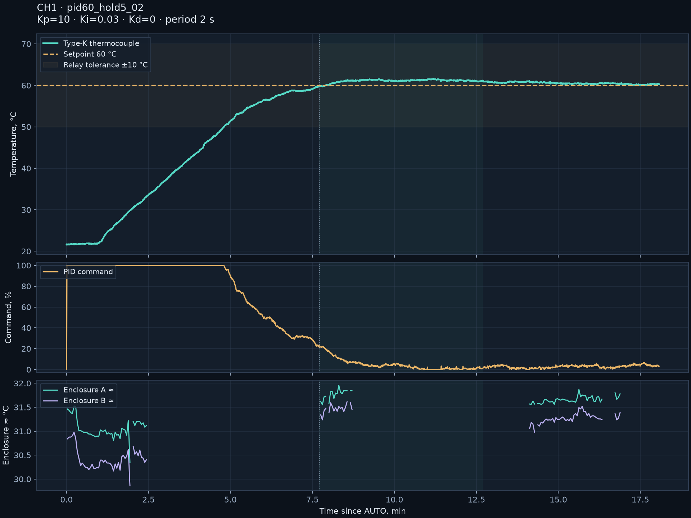

# TemperatureController-CH1 — temperature under observation

[Русский](README.md) | **English** · [Translation workflow](docs/TRANSLATIONS.en.md)

Repository: [neuroandriyanov/TemperatureController-CH1](https://github.com/neuroandriyanov/TemperatureController-CH1).

**A single-channel temperature controller and an open measurement bench.** STM32F030C8T6, eight thermocouple types, AC RMS current, Modbus RTU, autonomous PID and triac burst control with a period of 2–300 s.

A NeuroAndriyanov project: from schematics and source code to verifiable measurements. Current firmware: **2.5.0**; protocol: **2.4**. Parameters are stored in the device's EEPROM. The PC is used for configuration, calibration and observation; controller operation is not tied to water or a particular heater.

This repository brings together custom electronics, firmware, four PC applications, schematics, an enclosure part and real measurements. The project develops through collaboration between a human and AI: from input checks and calibration to controller tuning and observing heating. Raw data, unsuccessful experiments and limitations are retained so the work can be checked and continued.


*An original test frame: the controller is on the right, the clamp is in the center and the calibrator is behind it. Thermal markers were unavailable at this moment; the original labels have not been retouched. [Test photographs and thermograms](measurements/2026-11-07_heater_60c/README.en.md), [hardware materials](hardware/README.en.md).*

## Where to start

| I want to… | Go to |
|---|---|
| Run the applications and build the firmware | [Quick start](docs/QUICKSTART.en.md) |
| Study the boards, enclosure and connections | [Hardware materials](hardware/README.en.md) |
| Write my own control application | [Modbus RTU and parameter map](firmware/docs/PROTOCOL.en.md) |
| See how testing was performed | [Bench, measurements, photographs and plots](measurements/README.en.md) |
| Continue development with AI | [Assistant instructions](docs/AI_START.en.md) and [knowledge base](knowledge/README.en.md) |
| Check the source package | [Build and test report](docs/VALIDATION.en.md) |

The package also includes an [HTML overview with photographs](docs/index.en.html): after downloading the project, open `docs/index.en.html` in a browser.

The [English-edition verification note](docs/ENGLISH_RELEASE.md) describes translated documents, plots and editable BOMs, the preserved evidence, and checks performed for this edition.

## How the bench works

The MAX31856 reads the thermocouple; the ACS712 measures load current. The STM32 computes PID and drives the triac in bursts of mains cycles. Cold-junction compensation can use the internal sensor or an external Pt100 through a signal transmitter and the 4–20 mA input. Modbus RTU over RS-485 connects the device to its configuration application; once configured, the controller operates independently.

The LB02A calibrator supplies reference input signals. A normal camera shows the bench and clamp readings, while the UTi260B thermal imager shows surface temperature distribution. The observation application overlays the images, transfers temperature markers and saves paired snapshots. These same interfaces allow an AI assistant to carry out explicitly assigned measurements and save their results.

## Contents

| Directory | Contents |
|---|---|
| [apps/calibrator_lb02a](apps/calibrator_lb02a/README.en.md) | LB02A screen and keys, ESP32-S3 bridge source, connection photographs |
| [apps/thermal_monitor](apps/thermal_monitor/README.en.md) | Color video, UTi260B, layer alignment, temperature markers, paired snapshots, local API |
| [apps/controller](apps/controller/README.en.md) | Controller configuration, calibration, faults, temperature plot, AUTO/MANUAL/STOP |
| [apps/stm32_programmer](apps/stm32_programmer/README.en.md) | UART bootloader: BIN/Intel HEX, viewing, backup, erase, write and verify |
| [firmware](firmware/README.en.md) | Current STM32 source, ST/ARM libraries, build and tests |
| [hardware](hardware/README.en.md) | PDF schematics, BOMs, Gerbers, enclosure STL, photographs |
| [measurements](measurements/README.en.md) | Thermocouple, 4–20 mA loop, current, PID and enclosure-temperature measurements |
| [knowledge](knowledge/README.en.md) | NeuroEngineer knowledge base: sources, facts, limitations and checksums |

## Starting on a new PC

Windows 10/11 x64, Python **3.12–3.15** with Tcl/Tk. Extract the project into a writable directory. Internet access is required for the initial dependency installation.

```powershell
python setup.py
python run.py controller
python run.py thermal
python run.py calibrator
python run.py programmer
```

On Windows, `setup.cmd` and the four `start-*.cmd` files are also available. The user selects ports and cameras; another workstation's settings and USB identifiers are not included. Connections and heating do not start automatically on first launch. Camera capture uses DirectShow: this part has only been tested on Windows. The STM32 build and core tests also support Linux; individual applications have not undergone hardware testing outside Windows.

To build the firmware, install Arm GNU Toolchain with newlib and add `arm-none-eabi-gcc` to PATH, or set `ARM_GCC_DIR` to its `bin` directory:

```powershell
python firmware/scripts/build.py
```

Outputs: `firmware/build/controller.bin` and `.hex`. Building does not write anything to a device. [Flashing and first-start procedure](docs/QUICKSTART.en.md).

## What has been checked



Eight thermocouple types: 35 points. Direct 4–20 mA input: five points. Pt100 → signal transmitter → controller: −10…150 °C and return to zero. Two current points and a separate comparison check. Water held near 60 °C after PID tuning: the final five minutes were **60.0…61.1 °C**, mean **60.51 °C**. These are results for one device and a particular load, not guaranteed accuracy for any thermal system.

The first coefficient set caused temperature overshoot; it is retained alongside the successful experiment. The thermal imager observed the outer enclosure: the triac junction and concealed heatsink temperatures were not measured. UTi260B palette estimates are approximate, and missing values are not hidden. [Method and limitations](measurements/README.en.md).

```powershell
python env.py scripts/test.py --native
```

Native tests require GCC/Clang or Visual Studio C++ Build Tools. [Package verification report](docs/VALIDATION.en.md). Tests do not open connections to real instruments.

Prepared snapshot integrity: `python scripts/verify_bundle.py` checks `MANIFEST.sha256`. After your own edits, hash differences are expected; the old manifest describes the original publication copy.

## Licenses

Original code, documentation and original photographs: [MIT](LICENSE). Hardware materials: [CERN-OHL-P-2.0](LICENSES/CERN-OHL-P-2.0.txt), as in other NeuroAndriyanov projects. ST, ARM and UTi260B decoder terms are preserved separately: [NOTICE](NOTICE.en.md). The package contains source code, without manufacturer installers or binary builds of third-party libraries.
