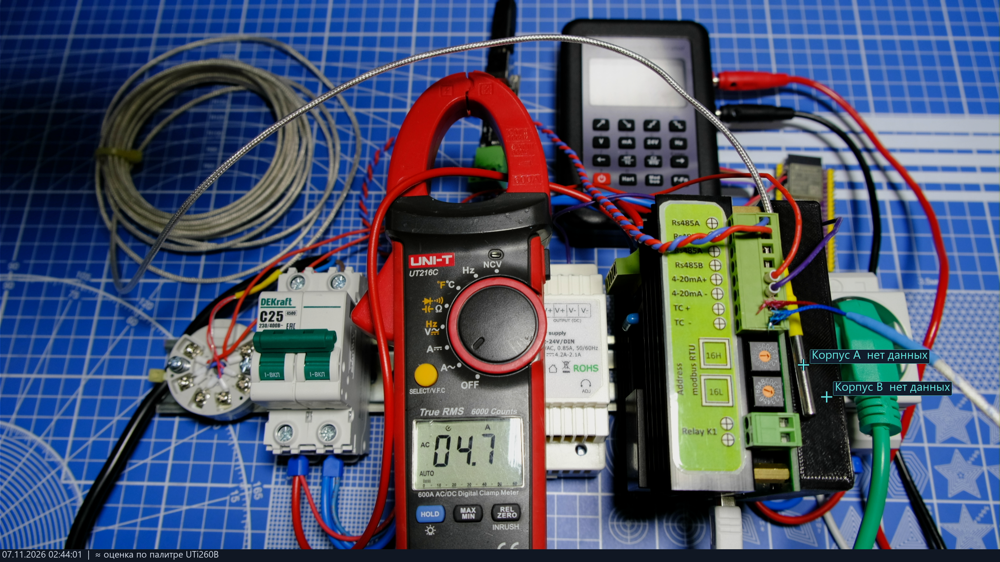
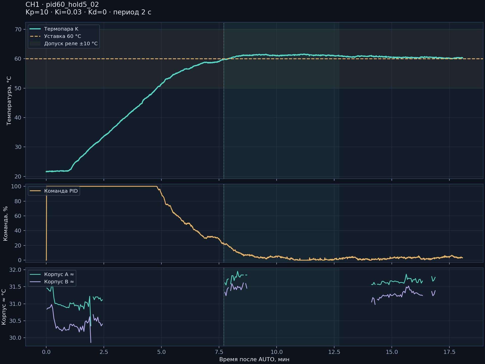

**Русский** | [English](README.en.md)

Правила публикации сначала на русском, затем на английском: [перевод и проверка актуальности](docs/TRANSLATION.md).

# TemperatureController-CH1 — температура под наблюдением

Репозиторий: [neuroandriyanov/TemperatureController-CH1](https://github.com/neuroandriyanov/TemperatureController-CH1).

**Одноканальный терморегулятор и открытый измерительный стенд.** STM32F030C8T6, восемь типов термопар, ток AC RMS, Modbus RTU, автономный PID и пакетное управление симистором с периодом 2–300 с.

Проект NeuroAndriyanov: от схемы и исходного кода до проверяемых измерений. Актуальная прошивка **2.5.0**, протокол **2.4**. Параметры хранятся в EEPROM прибора. ПК используется для настройки, калибровки и наблюдения; работа регулятора не привязана к воде или определённому нагревателю.

Здесь собраны собственная электроника, прошивка, четыре программы для ПК, схемы, корпус и реальные измерения. Проект развивается в совместной работе человека и ИИ: от проверки входов и калибровки до настройки регулятора и наблюдения нагрева. Исходные данные, неудачные опыты и ограничения сохранены, чтобы работу можно было проверить и продолжить.



*Реальный кадр испытания: регулятор справа, клещи в центре, калибратор сзади. В этот момент тепловые отметки недоступны; подписи сохранены без ретуши. [Фотографии и термограммы опыта](measurements/2026-11-07_heater_60c/README.md), [аппаратные материалы](hardware/README.md).*

## С чего начать

| Хочется… | Куда перейти |
|---|---|
| Запустить программы и собрать прошивку | [Быстрый старт](docs/QUICKSTART.md) |
| Изучить платы, корпус и подключения | [Аппаратные материалы](hardware/README.md) |
| Написать свою программу управления | [Modbus RTU и карта параметров](firmware/docs/PROTOCOL.md) |
| Посмотреть, как выполнялись испытания | [Стенд, измерения, фотографии и графики](measurements/README.md) |
| Продолжить разработку с ИИ | [Инструкция для помощника](docs/AI_START.md) и [база знаний](knowledge/README.md) |
| Проверить исходный комплект | [Отчёт о сборках и тестах](docs/VALIDATION.md) |

В комплекте есть также [HTML-обзор с фотографиями](docs/index.html): после скачивания проекта откройте `docs/index.html` в браузере.

## Как устроен стенд

Термопару считывает MAX31856, ток нагрузки — ACS712. STM32 рассчитывает PID и управляет симистором пакетами сетевых периодов. Холодный спай можно компенсировать по внутреннему датчику или внешнему Pt100 через нормирующий преобразователь и вход 4–20 мА. Modbus RTU по RS-485 связывает прибор с программой настройки; после настройки контроллер работает самостоятельно.

Калибратор LB02A задаёт контрольные сигналы. Обычная камера показывает стенд и показания клещей, тепловизор UTi260B — распределение температуры поверхности. Программа наблюдения совмещает изображения, переносит температурные точки и сохраняет парные снимки. Эти же интерфейсы позволяют ИИ-помощнику выполнять явно заданные измерения и сохранять их результаты.

## Состав

| Каталог | Содержимое |
|---|---|
| [apps/calibrator_lb02a](apps/calibrator_lb02a/README.md) | Экран и кнопки LB02A, исходники моста ESP32-S3, фотографии подключения |
| [apps/thermal_monitor](apps/thermal_monitor/README.md) | Цветное видео, UTi260B, совмещение слоёв, температурные точки, парные снимки, локальный API |
| [apps/controller](apps/controller/README.md) | Настройки регулятора, калибровка, ошибки, график температуры, AUTO/MANUAL/STOP |
| [apps/stm32_programmer](apps/stm32_programmer/README.md) | UART-загрузчик: BIN/Intel HEX, просмотр, резервная копия, стирание, запись и проверка |
| [firmware](firmware/README.md) | Текущий исходный код STM32, библиотеки ST/ARM, сборка и тесты |
| [hardware](hardware/README.md) | PDF-схемы, BOM, Gerber, STL корпуса, фотографии |
| [measurements](measurements/README.md) | Измерения термопар, петли 4–20 мА, тока, PID и температуры корпуса |
| [knowledge](knowledge/README.md) | База знаний для нейроинженера: источники, факты, ограничения и контрольные суммы |

## Запуск на новом ПК

Windows 10/11 x64, Python **3.12–3.15** с Tcl/Tk. Распакуйте проект в доступную для записи папку. Интернет нужен для первой установки зависимостей.

```powershell
python setup.py
python run.py controller
python run.py thermal
python run.py calibrator
python run.py programmer
```

На Windows можно использовать `setup.cmd` и четыре файла `start-*.cmd`. Порты и камеры выбираются пользователем; чужие настройки и USB-идентификаторы в комплект не входят. При первом запуске соединения и нагрев автоматически не включаются. Для камеры используется DirectShow: эта часть проверена только на Windows. Сборка STM32 и тесты ядра рассчитаны также на Linux; отдельные приложения вне Windows не проходили аппаратную проверку.

Для сборки прошивки установите Arm GNU Toolchain с newlib, добавьте `arm-none-eabi-gcc` в PATH или задайте `ARM_GCC_DIR` на каталог `bin`:

```powershell
python firmware/scripts/build.py
```

Результат: `firmware/build/controller.bin` и `.hex`. Сборка ничего не записывает в устройство. [Порядок прошивки и первого пуска](docs/QUICKSTART.md).

## Что проверено



Восемь типов термопар: 35 точек. Прямой вход 4–20 мА: пять точек. Pt100 → НПТ → регулятор: −10…150 °C и возврат к нулю. Две токовые точки и отдельное контрольное сравнение. Удержание воды около 60 °C после настройки PID: последние пять минут **60,0…61,1 °C**, среднее **60,51 °C**. Это результаты одного экземпляра и конкретной нагрузки, не гарантированная точность для любого объекта.

Первый набор коэффициентов вызвал выбег температуры; он сохранён рядом с удачным опытом. Тепловизор наблюдал наружный корпус: температура кристалла симистора и скрытого радиатора не измерена. Оценки UTi260B по палитре приблизительные, пропуски не скрыты. [Методика и ограничения](measurements/README.md).

```powershell
python env.py scripts/test.py --native
```

Для native-тестов нужен GCC/Clang либо Visual Studio C++ Build Tools. [Отчёт о проверке комплекта](docs/VALIDATION.md). Связь с реальными приборами тесты не открывают.

Целостность подготовленного снимка: `python scripts/verify_bundle.py` проверяет `MANIFEST.sha256`. После ваших изменений несовпадение хешей ожидаемо; старый манифест описывает именно исходную публикационную копию.

## Лицензии

Авторский код, документация и авторские фотографии — [MIT](LICENSE). Аппаратные материалы — [CERN-OHL-P-2.0](LICENSES/CERN-OHL-P-2.0.txt), как в других проектах NeuroAndriyanov. Условия ST, ARM и декодера UTi260B сохранены отдельно: [NOTICE](NOTICE.md). Пакет содержит исходники, без установщиков производителя и бинарных сборок сторонних библиотек.
