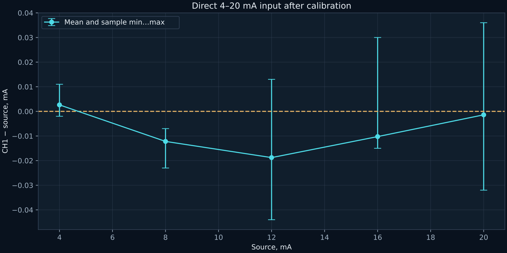
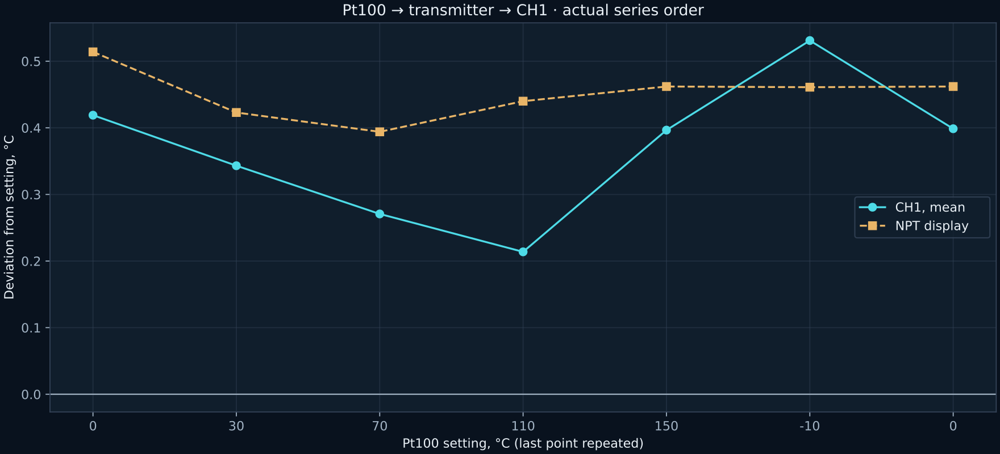

[Русский](README.md) | **English**

# Direct current input and Pt100 → NPT → CH1

## 1. 4–20 mA range and calibration

LB02A was connected as a current source directly to the CH1 input, without the NPT conditioner or external 24 V in this measurement circuit. Programming USB was disconnected. RP1 adjustment was insufficient: 20 mA reached approximately 225.14 kHz. On the tested board, R17 was replaced from 62 to 47 kΩ, and RP1 was backed off two turns. The original BOM/schematic remains unchanged.

Firmware 2.3 corrected the lower bound of the AD7741 period check: 180 instead of 200 TIM1 ticks. This accepts normal short intervals of 192 ticks at CLKIN=500 kHz. Calibration points for this unit: **372 and 1906 mV**; they are not defaults for other boards.

| Source, mA | CH1 mean, mA |
|---:|---:|
| 4 | 4.00263 |
| 8 | 7.98780 |
| 12 | 11.98122 |
| 16 | 15.98976 |
| 20 | 19.99859 |

The maximum absolute **mean** deviation of these five points is 0.01878 mA. Individual samples vary more; `loop_calibration_validation.json` contains min/max values. A repeated 4 mA point is also retained.

## 2. Complete chain

NPT configuration: Pt100, α=0.00385, range −10…150 °C → 4…20 mA, 1 s filter, 22 mA fault current. It was configured for four-wire operation, but physically used two leads and jumpers 4–5/2–3: positive to 4, negative to 3. Lead resistance contributes error; this is not a complete four-wire source connection.

The calibrator ran from its battery with USB disconnected; points were changed using its keys. NPT was connected to USB, and CH1 was read over isolated RS-485. Earlier, calibrator USB caused a false increase in readings; the specific parasitic-current path was not measured.

| Pt100, °C | NPT, °C | CH1 mean, °C |
|---:|---:|---:|
| 0 | 0.514 | 0.41897 |
| 30 | 30.423 | 30.34310 |
| 70 | 70.394 | 70.27069 |
| 110 | 110.440 | 110.21379 |
| 150 | 150.462 | 150.39655 |
| −10 | −9.539 | −9.46897 |
| 0 repeated | 0.462 | 0.39863 |

The first six points contain 58 samples each; the repeated zero contains 73. Maximum CH1 mean deviation: 0.53103 °C; maximum individual-sample deviation: 1.0 °C. The repeated-zero mean differs from the first by −0.02034 °C.

The external channel is valid; at this stage, fault flag 8192 refers to ACS712 calibration that had not yet been confirmed. Describing this series as “no faults in the entire device” would therefore be incorrect.

Original summaries: [npt_chain_result.json](npt_chain_result.json), [loop_calibration_validation.json](loop_calibration_validation.json). Final-connection images: `photos/npt_final_recovered`. Results describe the full chain and selected connection; the entire difference cannot be attributed solely to the ADC or solely to the Pt100.
