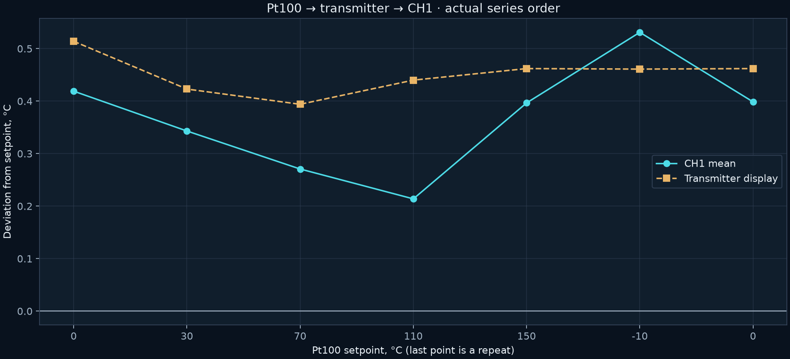

# Direct current input and Pt100 → transmitter → CH1

[Русский](README.md) | **English**

## 1. 4–20 mA range and calibration

The LB02A was connected as a current source directly to the CH1 input, without the transmitter or external 24 V in this measurement circuit. Programming USB was disconnected. RP1 adjustment was insufficient: 20 mA reached approximately 225.14 kHz. On the tested board, R17 was replaced from 62 to 47 kΩ and RP1 was backed off two turns. The original BOM/schematic remains unchanged.

Firmware 2.3 corrected the AD7741 period-validation lower limit: 180 rather than 200 TIM1 ticks. This admits normal short intervals of 192 ticks with CLKIN=500 kHz. This device's calibration points are **372 and 1906 mV**; they are not defaults for other boards.

| Source, mA | CH1 mean, mA |
|---:|---:|
| 4 | 4.00263 |
| 8 | 7.98780 |
| 12 | 11.98122 |
| 16 | 15.98976 |
| 20 | 19.99859 |

The maximum absolute **mean** deviation across these five points is 0.01878 mA. Individual readings have a larger spread; `loop_calibration_validation.json` includes min/max. A repeated 4 mA point is also retained.

## 2. The complete chain

Transmitter (НПТ/NPT): Pt100, α=0.00385, range −10…150 °C → 4…20 mA, 1 s filter, fault current 22 mA. It was configured for four-wire operation, but physically used two wires and jumpers 4–5/2–3: positive on 4, negative on 3. Lead resistance contributes error; this is not a full four-wire connection to the source.

The calibrator ran on battery with its USB disconnected; points were selected using keys. The transmitter was connected to USB, and CH1 was read over isolated RS-485. A false increase in readings had previously been observed with calibrator USB connected; the specific parasitic-current path was not measured.

| Pt100, °C | Transmitter, °C | CH1 mean, °C |
|---:|---:|---:|
| 0 | 0.514 | 0.41897 |
| 30 | 30.423 | 30.34310 |
| 70 | 70.394 | 70.27069 |
| 110 | 110.440 | 110.21379 |
| 150 | 150.462 | 150.39655 |
| −10 | −9.539 | −9.46897 |
| 0 repeated | 0.462 | 0.39863 |

The first six points have 58 samples each; the repeated zero has 73. Maximum CH1 mean deviation is 0.53103 °C; maximum individual-reading deviation is 1.0 °C. The repeated-zero mean differs from the first by −0.02034 °C.

The external channel is valid; during this phase, fault flag 8192 refers to the not-yet-confirmed ACS712 calibration. Describing this series as having “no faults in the entire instrument” would therefore be incorrect.

Original summaries: [npt_chain_result.json](npt_chain_result.json), [loop_calibration_validation.json](loop_calibration_validation.json). Final-connection snapshots: `photos/npt_final_recovered`. Results describe the whole chain and chosen wiring; the entire difference cannot be attributed only to the ADC or only to the Pt100.
