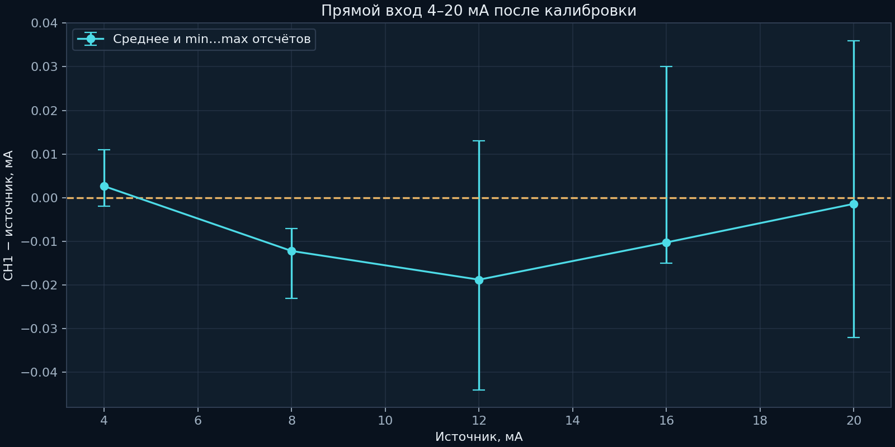
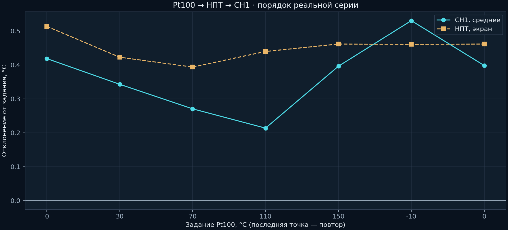

# Прямой токовый вход и Pt100 → НПТ → CH1

## 1. Диапазон и калибровка 4–20 мА

LB02A подключён источником тока напрямую ко входу CH1, без НПТ и внешних 24 В в этой измерительной цепи. USB загрузки отключён. Подстройки RP1 оказалось недостаточно: 20 мА достигали примерно 225,14 кГц. На испытанной плате R17 заменён с 62 на 47 кОм, RP1 возвращён на два оборота. Исходный BOM/схема остаются прежними.

В прошивке 2.3 исправлена нижняя граница проверки периодов AD7741: 180 вместо 200 тактов TIM1. Это допускает нормальные короткие интервалы 192 такта при CLKIN=500 кГц. Калибровочные точки этого экземпляра: **372 и 1906 мВ**; они не являются defaults для чужих плат.

| Источник, мА | Среднее CH1, мА |
|---:|---:|
| 4 | 4,00263 |
| 8 | 7,98780 |
| 12 | 11,98122 |
| 16 | 15,98976 |
| 20 | 19,99859 |

Максимальное абсолютное **среднее** отклонение этих пяти точек — 0,01878 мА. Разброс отдельных отсчётов больше; `loop_calibration_validation.json` содержит min/max. Повтор 4 мА также сохранён.

## 2. Вся цепочка

НПТ: Pt100, α=0,00385, диапазон −10…150 °C → 4…20 мА, фильтр 1 с, аварийный ток 22 мА. Настройка четырёхпроводная, но физически использовались два провода и перемычки 4–5/2–3: плюс на 4, минус на 3. Сопротивление проводов вносит погрешность; это не полноценное четырёхпроводное соединение с источником.

Калибратор питался от аккумулятора, его USB отключён; точки переключались кнопками. НПТ был подключён к USB, CH1 читался по изолированному RS-485. При USB калибратора ранее наблюдалось ложное повышение показаний; конкретный путь паразитного тока не измерен.

| Pt100, °C | НПТ, °C | Среднее CH1, °C |
|---:|---:|---:|
| 0 | 0,514 | 0,41897 |
| 30 | 30,423 | 30,34310 |
| 70 | 70,394 | 70,27069 |
| 110 | 110,440 | 110,21379 |
| 150 | 150,462 | 150,39655 |
| −10 | −9,539 | −9,46897 |
| 0 повтор | 0,462 | 0,39863 |

Первые шесть точек — по 58 отсчётов, повтор нуля — 73. Максимальное среднее отклонение CH1 — 0,53103 °C, максимальное отклонение отдельного отсчёта — 1,0 °C. Повтор нуля отличается от первого среднего на −0,02034 °C.

Внешний канал достоверен; в этой фазе флаг ошибки 8192 относится к ещё неподтверждённой калибровке ACS712. Поэтому описание «ошибок всего прибора нет» для этой серии было бы неверным.

Исходные сводки: [npt_chain_result.json](npt_chain_result.json), [loop_calibration_validation.json](loop_calibration_validation.json). Снимки итогового подключения: `photos/npt_final_recovered`. Результаты описывают всю цепь и выбранное подключение; нельзя приписать всю разницу только ADC или только Pt100.
