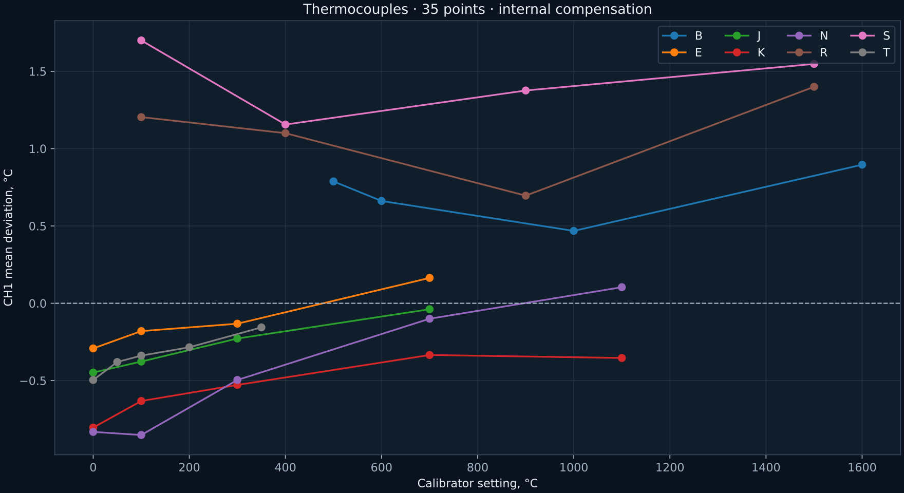

[Русский](README.md) | **English**

# Thermocouple input · 6 November 2026

Firmware 2.2; heating disabled. LB02A connected to TC+/TC− through copper test leads. The controller used internal compensation. For comparison, the calibrator's cold-junction value was set manually from the MAX31856 before each thermocouple-type series; changes in internal temperature over time remain an error source.

After correcting a poor contact, checks were performed at 0/5 mV, with a jumper directly across the TC terminals, and for the influence of the programming USB port. An early type K 100 °C series gave 86.6…165.3 °C. After disconnecting programming USB, using normal power and isolated RS-485, the result became 99.4…99.6 °C. The jumper produced approximately the internal cold-junction temperature, 31.3…31.5 °C. A reverse experiment reconnecting USB was not performed, and leads were reconnected; the common-ground hypothesis has not been conclusively separated from contact quality.

The final series contains 35 points and 884 samples, with zero MAX31856 status values. Ranges of mean “controller minus source” deviations:

| Type | Tested temperatures, °C | Mean deviation by point, °C |
|---|---:|---:|
| B | 500…1600 | +0.47…+0.90 |
| E | 0…700 | −0.29…+0.16 |
| J | 0…700 | −0.45…−0.04 |
| K | 0…1100 | −0.80…−0.33 |
| N | 0…1100 | −0.85…+0.10 |
| R | 100…1500 | +0.70…+1.40 |
| S | 100…1500 | +1.16…+1.70 |
| T | 0…350 | −0.50…−0.16 |

Data: [temperature_points.json](temperature_points.json), [validation.json](validation.json), primary `raw/*_samples.json`. The summary stores min/max/stddev and the manually set cold-junction value. Photographs: `photos/setup` and `photos/isolated_measurement`.

These deviations do not establish absolute sensor accuracy or accuracy across the MAX31856's entire temperature range. Without specified LB02A and cold-junction uncertainties, this cannot be called metrological verification. External compensation was not tested here.
