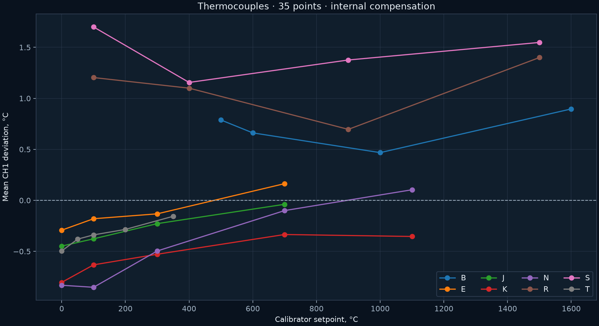

# Thermocouple input · 2026-11-06

[Русский](README.md) | **English**

Firmware 2.2; heating disabled. The LB02A was connected to TC+/TC− using copper measurement leads. Controller compensation was internal. For the comparison, the calibrator's cold-junction value was manually set from the MAX31856 before each thermocouple-type series; internal-temperature changes over time remain an error source.

After fixing a poor contact, checks covered 0/5 mV, a jumper directly across the TC terminals, and the effect of the programming USB port. At K 100 °C, an early series produced 86.6…165.3 °C. After disconnecting the programming USB, using the normal supply and isolated RS-485, results became 99.4…99.6 °C. The jumper indicated approximately the internal cold-junction temperature, 31.3…31.5 °C. No reverse test restoring USB was performed, and leads were reconnected; the common-ground hypothesis was not conclusively separated from contact quality.

The final series contains 35 points and 884 samples, with zero MAX31856 status flags. Ranges of mean “controller minus source” deviations:

| Type | Tested temperatures, °C | Mean deviation across points, °C |
|---|---:|---:|
| B | 500…1600 | +0.47…+0.90 |
| E | 0…700 | −0.29…+0.16 |
| J | 0…700 | −0.45…−0.04 |
| K | 0…1100 | −0.80…−0.33 |
| N | 0…1100 | −0.85…+0.10 |
| R | 100…1500 | +0.70…+1.40 |
| S | 100…1500 | +1.16…+1.70 |
| T | 0…350 | −0.50…−0.16 |

Data: [temperature_points.json](temperature_points.json), [validation.json](validation.json), primary `raw/*_samples.json`. The summary retains min/max/stddev and the manually entered cold-junction value. Photographs: `photos/setup` and `photos/isolated_measurement`.

These deviations do not establish absolute sensor accuracy or accuracy across the entire MAX31856 temperature range. Without specified LB02A and cold-junction uncertainty, this cannot be called metrological verification. External compensation was not tested here.
