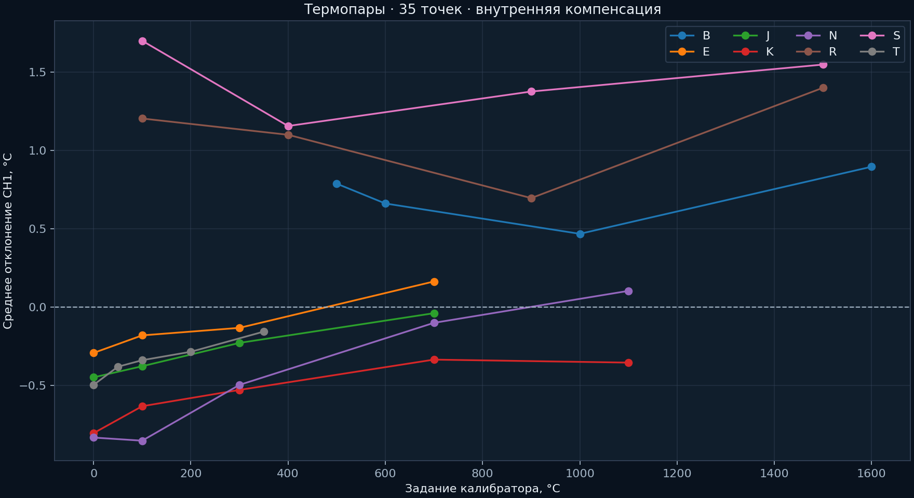

# Термопарный вход · 06.11.2026

Прошивка 2.2; нагрев отключён. LB02A подключён медными измерительными проводами к TC+/TC−. Компенсация регулятора внутренняя. При сравнении калибратору вручную задавали холодный спай по MAX31856 перед серией типа; изменение внутренней температуры во времени остаётся источником ошибки.

После устранения плохого контакта были выполнены проверки 0/5 мВ, перемычки непосредственно на TC-клеммах и влияния USB-порта загрузки. При K 100 °C ранняя серия давала 86,6…165,3 °C. После отключения USB загрузки, при штатном питании и изолированном RS-485, результат стал 99,4…99,6 °C. Перемычка показывала около внутреннего холодного спая 31,3…31,5 °C. Обратный опыт с восстановлением USB не выполнен, провода переподключались; гипотеза общей земли не отделена окончательно от качества контакта.

В итоговой серии 35 точек и 884 отсчёта, статусы MAX31856 нулевые. Диапазоны средних отклонений «регулятор минус источник»:

| Тип | Проверенные температуры, °C | Среднее отклонение по точкам, °C |
|---|---:|---:|
| B | 500…1600 | +0,47…+0,90 |
| E | 0…700 | −0,29…+0,16 |
| J | 0…700 | −0,45…−0,04 |
| K | 0…1100 | −0,80…−0,33 |
| N | 0…1100 | −0,85…+0,10 |
| R | 100…1500 | +0,70…+1,40 |
| S | 100…1500 | +1,16…+1,70 |
| T | 0…350 | −0,50…−0,16 |

Данные: [temperature_points.json](temperature_points.json), [validation.json](validation.json), первичные `raw/*_samples.json`. Сводка хранит min/max/stddev и ручное значение холодного спая. Фотографии: `photos/setup` и `photos/isolated_measurement`.

Эти отклонения не означают подтверждённую абсолютную точность датчика или всего температурного диапазона MAX31856. Без заданной неопределённости LB02A и холодного спая нельзя объявлять метрологическую поверку. Внешняя компенсация здесь не испытывалась.
