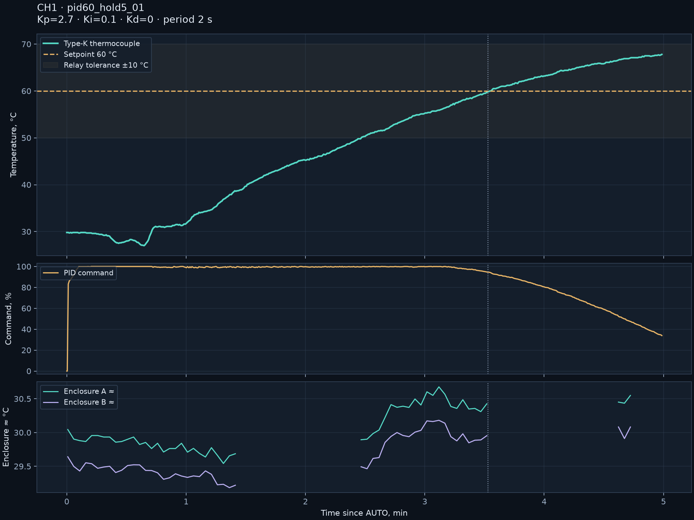
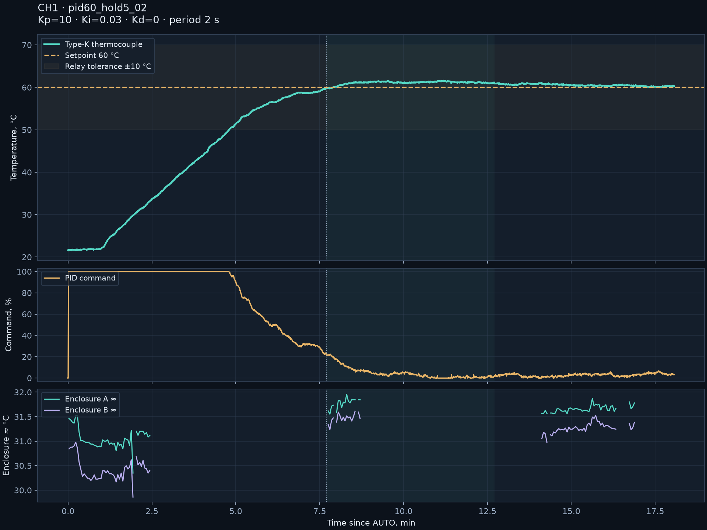
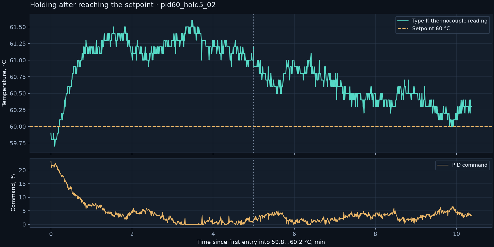
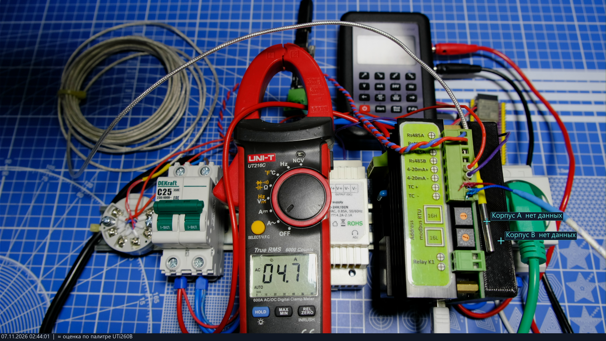
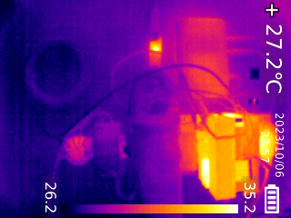

# Current, PID tuning and enclosure observation · 2026-11-07

[Русский](README.md) | **English**

## ACS712 30 A current

Zero-current noise was recorded before applying loads. Two load levels were compared with a UT216C AC clamp: approximately 4.74 and 7.80 A. Three frames of the second point show 7.85 / 7.80 / 7.75 A. The second-point load was manually enabled through the application for 20 s; STOP was sent after 20.015 s. During this current test, the thermocouple was not used as a sensor for the new load.

Device calibration: `CURRENT_GAIN_UA=20449`, `CURRENT_OFFSET_MA=-9`, noise 4.41 ADC counts. Current calculation:

```text
corrected = sqrt(max(0, raw_rms_counts² − 4.41²))
current_mA = max(0, corrected × 20449 / 1000 − 9)
```

After calibration at zero: 0…0.021 A, mean 0.0048 A. Separate subsequent clamp frames show 4.74 / 4.70 A; CH1 means in windows near those snapshots are 4.770 / 4.732 A. Difference is about 0.03 A; instruments were not synchronized. This does not establish accuracy over the entire 30 A range. Values are in this board's EEPROM, not substituted for factory defaults.

Data: `raw/current_two_point_saved.json`, `raw/current_stronger_20s_01.json`, `raw/current_independent_tank_check.json`. Original frames: `photos/current_stronger_20s_01_on_*`.

## Thermal system and method

Approximately 3 L of water according to the operator; an immersed heating element and type-K thermocouple in water. The water was replaced before the second experiment. Controller 2.5, setpoint 60 °C, internal cold junction, burst-control period 2 s. Process limit 70 °C. The ±10 °C tolerance belongs to the relay function, not a relaxation of PID accuracy; the relay was disabled in these experiments. External-channel temperature was observed, but no complete comparative series switching compensation sources was performed here.

## Two coefficient sets

| Parameter | First experiment | Repeated experiment |
|---|---:|---:|
| Kp / Ki / Kd | 2.7 / 0.1 / 0 | 10 / 0.03 / 0 |
| Time to first entry into 59.8…60.2 °C | 211.657 s | 462.203 s |
| Observation after reaching target | 87.5 s | 621.89 s |
| Maximum during AUTO | 67.8 °C | 61.6 °C |
| Five minutes completed | No | Yes |

The first PID kept output high near the setpoint: 94.6% at first attainment. Heating was stopped at 67.8 °C; subsequent thermal inertia is not part of the AUTO statistics. This useful negative result is retained in full.

Repeated experiment: AUTO 02:41:00.821 → STOP 02:59:05.170 (UTC+04:00), 1881 active samples, no active/latched faults during AUTO. First 300 s after attainment: 59.7…61.6 °C, mean 61.09. Final 300 s: **60.0…61.1 °C**, mean **60.51 °C**, σ=0.23 °C. Final minute: 60.0…60.4 °C, mean 60.22 °C. Mean output command during the final five minutes was 2.82%; this is an on-time fraction, not measured active electrical power.





## Enclosure and photographs

The UTi260B observed the outer enclosure to the right of the clamp. The heatsink and triac were concealed and not measured directly. The palette estimate is approximate: of 360 records in the active second experiment, markers A/B were available in 117; the remaining 243 are gaps from OSD/menu heuristics. Available A: ≈30.35…31.96 °C; B: ≈29.86…31.61 °C.

Four separately reviewed thermograms with no real menu gave A ≈31.51…31.73 °C and B ≈30.98…31.23 °C. The heuristic had falsely detected a menu; estimates were calculated separately using the same decoder, previous masks and a fresh scale. They were **not inserted** into gaps in the live log. Recalculation and original frames are available in `scripts/check_reviewed_thermal.py` and `raw/reviewed_thermal_estimates.json`.




The color camera periodically overheated, producing “NOT SUPPORT” or a black frame through the capture card. The gallery uses real readable frames; “нет данных” (“no data”) temperature labels were not retouched. Temperature markers are valid only with the original camera alignment.

At completion: STOP, gate=false, current 0, active and latched faults 0 were confirmed; EEPROM save sequence=36. Full logs: `raw/pid60_hold5_01.json`, `raw/pid60_hold5_02.json`; summary `raw/pid_analysis.json`; final state `raw/pid_final_stop.json`.

The PID set was found for this experiment. A nozzle heater or another mass/power requires its own coefficients/period and renewed verification. An enclosure temperature around 31 °C does not establish junction-temperature margin, insulation or long-term power-board safety.
