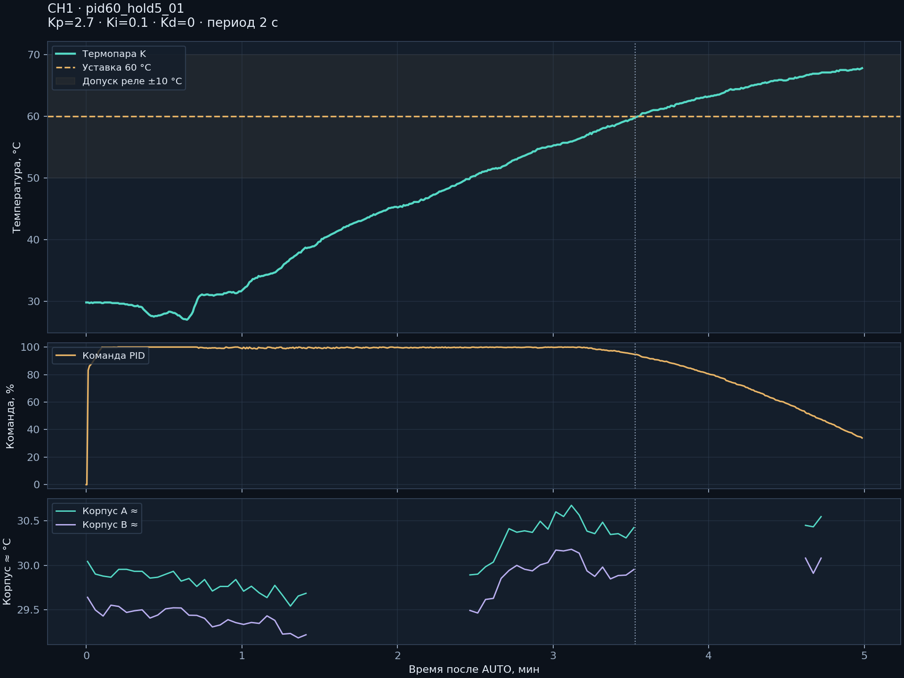
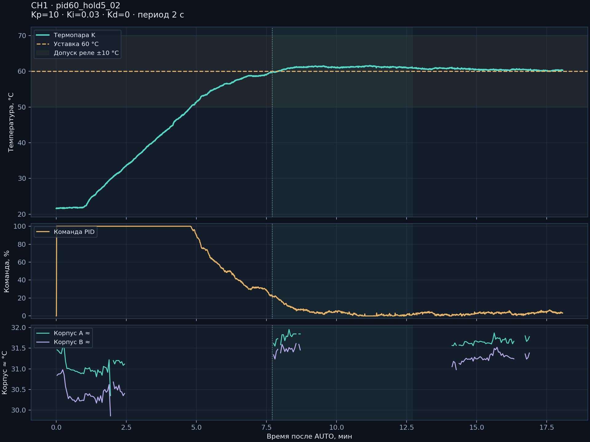
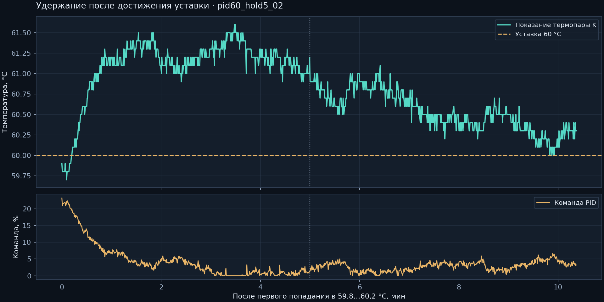
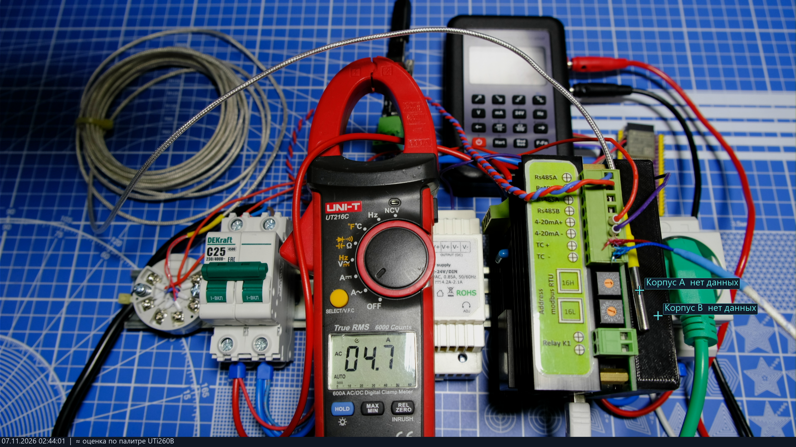
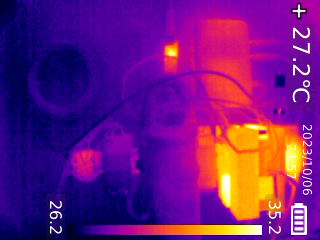

# Ток, настройка PID и наблюдение корпуса · 07.11.2026

## Ток ACS712 30 А

Перед включениями снят шум нулевого тока. Два нагрузочных уровня сравнивались с клещами UT216C AC: примерно 4,74 и 7,80 А. На трёх кадрах второй точки видно 7,85 / 7,80 / 7,75 А. Нагрузку второй точки включали вручную по программе на 20 с; STOP отправлен через 20,015 с. Термопара во время этой токовой проверки не использовалась как датчик новой нагрузки.

Калибровка экземпляра: `CURRENT_GAIN_UA=20449`, `CURRENT_OFFSET_MA=-9`, шум 4,41 ADC counts. Расчёт тока:

```text
corrected = sqrt(max(0, raw_rms_counts² − 4.41²))
current_mA = max(0, corrected × 20449 / 1000 − 9)
```

После калибровки на нуле: 0…0,021 А, среднее 0,0048 А. Отдельные последующие кадры клещей: 4,74 / 4,70 А; CH1 в окнах около снимков: 4,770 / 4,732 А. Расхождение около 0,03 А, измерители не синхронизированы. Это не подтверждение точности во всём диапазоне 30 А. Значения находятся в EEPROM этой платы, не подставлены вместо заводских defaults.

Данные: `raw/current_two_point_saved.json`, `raw/current_stronger_20s_01.json`, `raw/current_independent_tank_check.json`. Реальные кадры: `photos/current_stronger_20s_01_on_*`.

## Объект и методика

Около 3 л воды по сообщению оператора; погружённый ТЭН и термопара K в воде. Перед вторым опытом вода заменена. Контроллер 2.5, уставка 60 °C, внутренний холодный спай, период пакетного управления 2 с. Предел процесса 70 °C. Допуск ±10 °C предназначен для функции реле, не для ослабления точности PID; реле в этих опытах выключено. Температура внешнего канала наблюдалась, но полноценная сравнительная серия переключения компенсации здесь не выполнена.

## Два набора коэффициентов

| Параметр | Первый опыт | Повторный опыт |
|---|---:|---:|
| Kp / Ki / Kd | 2,7 / 0,1 / 0 | 10 / 0,03 / 0 |
| До первого попадания в 59,8…60,2 °C | 211,657 с | 462,203 с |
| Наблюдение после достижения | 87,5 с | 621,89 с |
| Максимум во время AUTO | 67,8 °C | 61,6 °C |
| Пять минут выдержаны | Нет | Да |

Первый PID оставлял большую мощность около уставки: 94,6% при первом достижении. Нагрев остановлен при 67,8 °C; дальнейшая тепловая инерция не является частью статистики AUTO. Это полезный отрицательный результат, он сохранён полностью.

Повторный опыт: AUTO 02:41:00,821 → STOP 02:59:05,170 (UTC+04:00), 1881 активный отсчёт, активных/зафиксированных аварий во время AUTO нет. Первые 300 с после достижения: 59,7…61,6 °C, среднее 61,09. Последние 300 с: **60,0…61,1 °C**, среднее **60,51 °C**, σ=0,23 °C. Последняя минута: 60,0…60,4 °C, среднее 60,22 °C. Средняя команда выхода в последние пять минут 2,82%; это доля времени, а не измеренная активная электрическая мощность.





## Корпус и фотографии

UTi260B наблюдал наружный корпус справа от клещей. Радиатор и симистор закрыты и напрямую не измерялись. Палитровая оценка приблизительная: из 360 записей активного второго опыта для точек A/B доступно 117, остальные 243 — пропуски OSD/эвристики меню. Доступные A: ≈30,35…31,96 °C, B: ≈29,86…31,61 °C.

Четыре отдельно просмотренные термограммы без реального меню дали A ≈31,51…31,73 °C и B ≈30,98…31,23 °C. Эвристика ошибочно отметила меню; оценки посчитаны отдельно тем же декодером, с прежними масками и свежей шкалой. Они **не вставлены** в пропуски live-журнала. Пересчёт и исходные кадры доступны в `scripts/check_reviewed_thermal.py` и `raw/reviewed_thermal_estimates.json`.




Цветная камера периодически перегревалась и выдавала «NOT SUPPORT»/чёрный кадр через карту захвата. Для галереи выбраны реальные читаемые кадры; отсутствие температуры на подписи «нет данных» не ретушировалось. Температурные точки действительны только при прежнем совмещении камер.

В конце подтверждены STOP, gate=false, ток 0, активные и зафиксированные аварии 0; сохранение EEPROM sequence=36. Полные журналы: `raw/pid60_hold5_01.json`, `raw/pid60_hold5_02.json`, сводка `raw/pid_analysis.json`, итог `raw/pid_final_stop.json`.

Набор PID найден для этого опыта. Для соплового нагревателя, другой массы или мощности нужны свои коэффициенты/период и повторная проверка. Температура корпуса около 31 °C не подтверждает запас температуры кристалла, изоляцию или длительную безопасность силовой платы.
