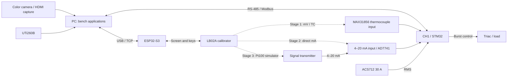

# CH1 measurement bench

[Русский](README.md) | **English**

We checked the measurement inputs in sequence, then current and regulation. Each stage retained numerical readings and original snapshots. AI helped read registers, operate applications, calculate corrections and draw plots; the operator performed wiring, soldering, BOOT0/RESET and some calibrator switching. The text below is a technical reconstruction from the data, without correspondence.

## Bench connections



Dashed connections were made **one at a time**, not simultaneously. For the heating stage, a real type-K thermocouple replaced the calibrator. The Pt100 for external compensation was placed near the terminals; internal compensation uses the MAX31856. The signal transmitter (НПТ/NPT in the original records) was configured using the manufacturer's installed utility, which is not part of this source package.

## Series

| Series | Results and materials |
|---|---|
| [Thermocouple input](2026-11-06_thermocouple_input/README.en.md) | B/E/J/K/N/R/S/T; 35 points, 884 samples; internal cold junction |
| [4–20 mA and Pt100/transmitter](2026-11-06_pt100_npt_loop/README.en.md) | Direct current calibration, R17 modification, whole-chain check over −10…150 °C |
| [Current, PID and thermal imaging](2026-11-07_heater_60c/README.en.md) | Two current points, unsuccessful and repeated PID experiments, more than 10 minutes of observation after reaching 60 °C |

PID settings and calibrations belong to the particular board and installation. This is a laboratory comparison using available instruments, without claimed metrological traceability. The full electrical and fault-test program is not complete.

## Reproduce the analysis without equipment

From the root, install with `python setup.py --dev`. Then:

```text
python env.py measurements/analyze.py
python env.py measurements/2026-11-07_heater_60c/scripts/plot_pid_runs.py
python env.py measurements/2026-11-07_heater_60c/scripts/check_reviewed_thermal.py
```

The scripts only read saved files and generate `plots` and `derived`; they do not open ports or energize the load. Primary JSON files in `raw` are not overwritten. For TC and the transmitter, analysis uses summary points referencing the original files; this is not new processing of the ADC electrical signal.

English plot derivatives use the same data and calculations: `python env.py measurements/analyze.en.py` and `python env.py measurements/2026-11-07_heater_60c/scripts/plot_pid_runs.en.py`. They write to `plots/en` and `derived/en`, leaving original outputs untouched.

Missing temperatures are not interpolated. PID statistics include AUTO records with valid `elapsed`; waiting, STOP and preparatory errors remain in the log but are not mixed into the active experiment. Recorded timestamps use the original UTC+04:00; the relative plot axis starts when AUTO was detected.

Selection and sanitization: [PROVENANCE.en.md](PROVENANCE.en.md). These data are a separate selection; internal dumps and the entire working-directory history are not included.
