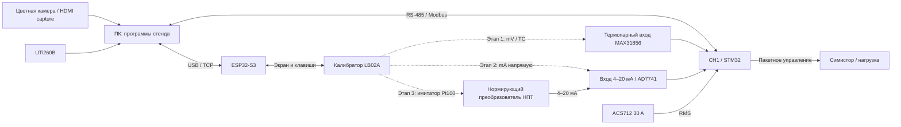

**Русский** | [English](README.en.md)

# Измерительный стенд CH1

Мы последовательно проверяли измерительные входы, затем ток и регулирование. Каждый этап сохранял численные отсчёты и реальные снимки. ИИ помогал читать регистры, управлять программами, рассчитывать поправки и строить графики; подключения, пайку, BOOT0/RESET и часть переключений калибратора выполнял оператор. Текст ниже — техническая реконструкция по данным, без переписки.

## Связи стенда



Пунктирные подключения выполнялись **по очереди**, не одновременно. На этапе нагрева вместо калибратора подключена реальная термопара K. Pt100 для внешней компенсации размещён около клемм; внутренняя компенсация использует MAX31856. Управление НПТ выполнялось установленной утилитой изготовителя — она не является частью этого исходного комплекта.

## Серии

| Серия | Результат и материалы |
|---|---|
| [Термопарный вход](2026-11-06_thermocouple_input/README.md) | B/E/J/K/N/R/S/T; 35 точек, 884 отсчёта; внутренний холодный спай |
| [4–20 мА и Pt100/НПТ](2026-11-06_pt100_npt_loop/README.md) | Прямая токовая калибровка, изменение R17, проверка всей цепочки −10…150 °C |
| [Ток, PID и тепловизор](2026-11-07_heater_60c/README.md) | Две токовые точки, неудачный и повторный PID-опыты, выдержка более 10 минут после достижения 60 °C |

Настройки PID и калибровки относятся к конкретной плате и установке. Это лабораторное сравнение с доступными приборами, без заявленной метрологической прослеживаемости. Полная программа электрических и аварийных испытаний не завершена.

## Как воспроизвести анализ без оборудования

Из корня установите `python setup.py --dev`. Затем:

```text
python env.py measurements/analyze.py
python env.py measurements/2026-11-07_heater_60c/scripts/plot_pid_runs.py
python env.py measurements/2026-11-07_heater_60c/scripts/check_reviewed_thermal.py
```

Скрипты читают только сохранённые файлы, строят `plots` и `derived`; порты и нагрузка не открываются. Первичные JSON в `raw` не перезаписываются. Для TC и НПТ анализ использует сводные точки с указанием первичных файлов; это не новая обработка электрического сигнала ADC.

Пропуски температур не интерполируются. В PID-статистику включены записи AUTO с действительным `elapsed`; ожидание, STOP и подготовительные ошибки сохранены в журнале, но не смешаны с активным опытом. Время в записях — исходное UTC+04:00, относительная ось графика начинается с обнаруженного AUTO.

Отбор и обезличивание: [PROVENANCE.md](PROVENANCE.md). Данные публикуются как отдельная подборка; служебные дампы и вся история рабочего каталога сюда не входят.
